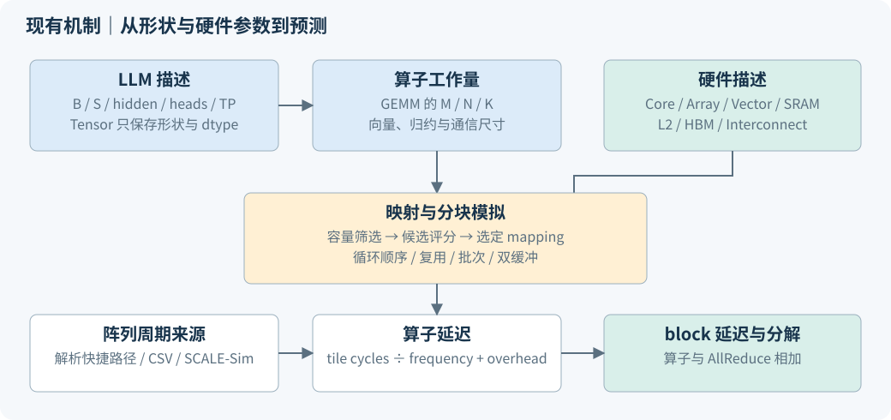
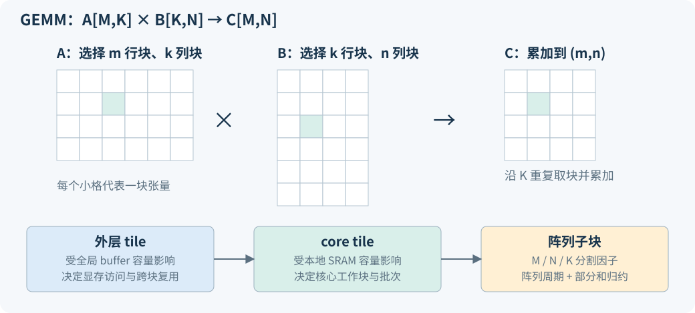
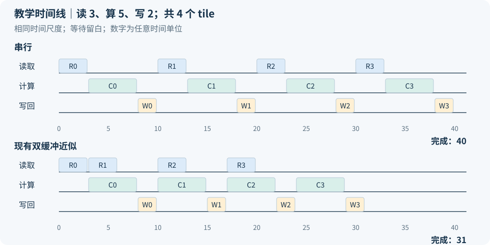
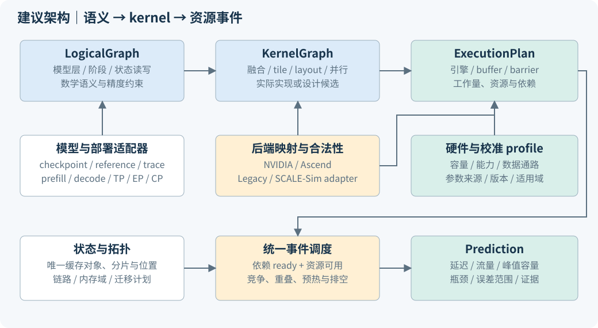
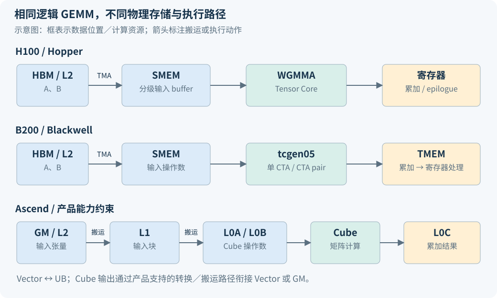
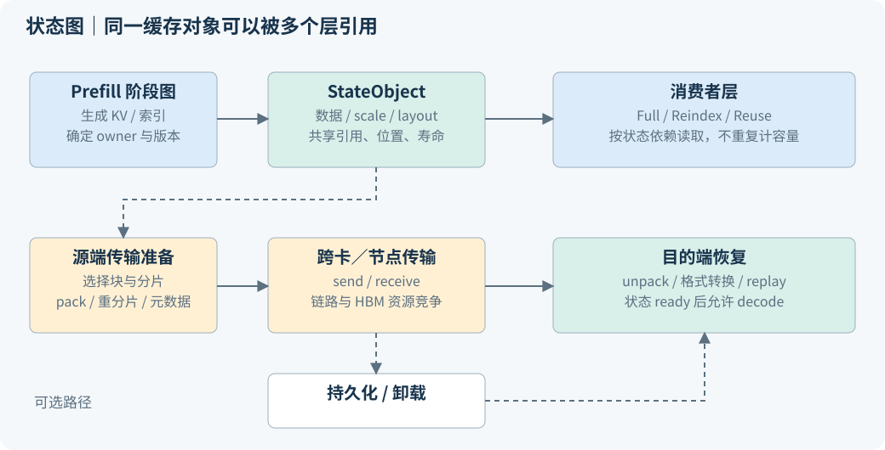
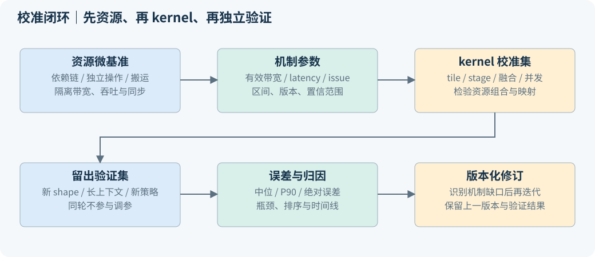

<div class="lead">
这份报告围绕一个问题展开：给定一个 LLM、一种并行策略和一组芯片，怎样把模型里的张量运算，变成可解释、可校准的执行时间？前半部分沿当前 LLMCompass 源码追踪答案；后半部分给出面向现代负载、H100／B200／B300 和 Ascend 910B／910C／950 的升级设计。
</div>

<div class="scope">
<strong>阅读与证据边界</strong><br>
源码基线：<code>2e015fd2ee750e6cad8d7152df52551e5b41ef20</code>。本次只新增报告与报告资产，没有修改模拟器、配置、查表或实验脚本。做了两个指定 GEMM 映射与四个 AllReduce 消息大小的限定只读执行；没有运行真实 GPU／NPU，也没有完成论文全量复现。文中明确区分“源码事实”“公式推导”“限定执行结果”和“新设计建议”。
</div>

## 1. 先建立整体认识：LLMCompass 模拟的对象是什么 {#overview}

LLMCompass 的主要产品是性能预测与设计空间比较。用户给出模型的张量尺寸、设备数量、数据类型和硬件参数后，它在 Python 中建立形状描述，把计算分成不同层次的 tile，估计 tile 的计算与搬运周期，再把它们汇总成算子和 Transformer block 的延迟。

这里的 `Tensor` 只保存 `shape`、元素个数和 `data_type`，不保存权重与激活的数值。`__call__()` 传播尺寸并检查维度；`compile_and_simulate()` 搜索映射并计算时间；`run_on_gpu()` 是另一条真实执行路径。这三个入口负责的事情不同。性能仿真成功不代表模型输出数值正确，真实算子运行成功也不代表完整推理系统已被复现。[源码：Tensor](../../../software_model/utils.py)、[Operator](../../../software_model/operators.py)



把模型分成两本账会更容易理解：**工作量账本**记录矩阵维度、计算次数、读写字节、归约和重复访问；**资源账本**记录核心数、每核心计算吞吐、容量、带宽、时钟与固定开销。映射器负责决定每项工作使用哪些资源，执行器负责计算完成时间。

当前计算图主要由 Python 对象和手写调用顺序表达。它没有一个统一保存所有节点、边、状态和资源依赖的通用图 IR。`Matmul.ComputationalGraph` 这个名字具体只表示 `M/N/K/dtype`。理解这个边界，才能判断哪些新功能可以加算子，哪些必须改变图的表达方式。

## 2. 贯穿实例：一个 GPT-3 block 怎样变成算子形状 {#example}

采用仓库 Figure 5 的一组配置：batch=8、输入序列长=2048、hidden size=12288、96 个 attention heads、TP=4、FP16。这里 TP 是张量并行：一个层的部分矩阵与 attention heads 分配到 4 张卡上。下面的形状和字节数均按**一个 rank、一个 block**计算。

`TransformerBlockInitComputationTP` 为 Q、K、V 分别建立权重 `[d,d/p]`，输出投影为 `[d/p,d]`；FFN 两个权重为 `[d,4d/p]` 和 `[4d/p,d]`。`Matmul.__call__()` 把输入最后一维之前的维度折叠成 M。因此 Q 投影的 `X[8,2048,12288] × Wq[12288,3072]` 被降为 GEMM：

$$M=16384,\quad N=3072,\quad K=12288.$$

| 当前 block 的步骤 | 单 rank 的主要形状 | 使用的现有对象 |
|---|---|---|
| Q／K／V 投影 | `[16384,12288] × [12288,3072]` | 三个 Matmul |
| QK | 192 组 `[2048,128] × [128,2048]` | BatchedMatmul |
| Softmax | 192 组 `2048 × 2048`，沿最后一维 | Softmax |
| AV | 192 组 `[2048,2048] × [2048,128]` | BatchedMatmul |
| 输出投影 | `[16384,3072] × [3072,12288]` | Matmul |
| FFN | `[16384,12288] × [12288,12288]`，再投影回 hidden | Matmul、GeLU、Matmul |
| 两处跨卡归约 | 每次 `[8,2048,12288]` | AllReduceMultiPCB |

证据位置：[transformer.py:20、60](../../../software_model/transformer.py)、[matmul.py:131](../../../software_model/matmul.py)。代码还放置两次 LayerNorm。报告按实际实现解释；不能据此认定它已包含完整 GPT-3 推理框架中的 embedding、残差处理、最终输出头和采样逻辑。

一次 Q 投影的有效工作量为：

$$F=2MNK=1{,}236{,}950{,}581{,}248\ \mathrm{FLOP}.$$

MAC 按乘、加两次运算计为 2 FLOP。假设输入、权重只读一遍，输出只写一遍，其最低数据量为：

$$D_{\min}=2(MK+KN+MN)=578{,}813{,}952\ \mathrm{Byte}=552\ \mathrm{MiB}.$$

这只是最少字节数；实际分块可能重复读取，也可能产生部分和读写。使用仓库内置 A100 参数，矩阵峰值约为 311.869 TFLOP/s，显存带宽为 2039 GB/s。由此推导的计算下界为 3.966 ms，显存搬运下界为 0.284 ms。**这些是手工公式经脚本核算的下界，不是这个 Q 投影的完整仿真结果。** 数据见 [evidence.json](evidence.json)。

attention 分数张量 `[8,24,2048,2048]` 的 FP16 大小达到每 rank 每层 1.5 GiB。当前代码为 QK、Softmax、AV 分别计时。现代融合 attention 可以把部分中间结果保留在片上，因此升级时要改变物理执行与数据移动描述，不能沿用“每个逻辑算子独立读写”的时间汇总方式。

decode 路径则将新 token 的 Q 投影变成 `M=batch` 的小 M GEMM，并构造历史 K/V。上述配置、历史长度 2048 时，逻辑 K/V 缓存合计每层每 rank 192 MiB。它与生成步数、batch 和 KV 表示相关；这个数字只适用于本例的普通 MHA，不能直接套到 GQA、MLA 或 CSA2。

## 3. 芯片怎样被表达：能力、容量与时间单位 {#hardware-old}

现有层次是 `System → Device → ComputeModule / IOModule / MemoryModule`。System 还含 InterConnectModule。Device 是一种设备模板；System 并没有保存一个可以逐张异构配置的设备列表。

ComputeModule 包含若干相同 Core、全局 buffer 和时钟。Core 包含 VectorUnit、若干 SystolicArray 和本地 SRAM。矩阵计算按等效脉动阵列估计，向量计算按向量宽度、数量和吞吐估计。该抽象便于比较不同设计，但 `16×16` 等效阵列不等同于 NVIDIA 指令形状，也不是已经确认的物理 Tensor Core 微架构。

$$P_{matrix}=N_{core}\times N_{array/core}\times H_{array}\times W_{array}\times MAC_{cycle}\times2\times f.$$

矩阵峰值单位是 FLOP/s；`l2_bandwidth_per_cycle` 是 Byte/cycle；`io_module.bandwidth` 是 Byte/s。把字节传输换成周期时，现有代码使用 `ceil(bytes / (bandwidth / frequency))`，最后再用 `cycle / frequency` 转为秒。[compute_module.py:118](../../../hardware_model/compute_module.py)、[matmul.py:1009](../../../software_model/matmul.py)

| 资源 | 当前表达 | 应如何理解 |
|---|---|---|
| 矩阵单元 | 阵列高宽、MAC/cycle、输入输出字节 | 等效计算能力与小 tile 利用率 |
| 向量单元 | FLOP/cycle、宽度、数量、exp 等效成本 | 元素计算与归约近似 |
| 本地 SRAM | 一个总容量 | 用于 tile 可行性；未细分真实存储用途 |
| 全局 buffer | 总容量、每周期带宽 | 近似片上共享存储与数据复用 |
| 外部内存 | 总容量；IO 模块提供带宽 | 容量约束与显存搬运计时分开 |
| 互联 | FC／RING、链路数、带宽、延迟、包开销 | 特定通信公式的输入 |

一个容易忽略的配置问题是：内置 `A100_fp16` 使用 108 个 core、40 MiB L2；`configs/GA100.json` 使用 128 个 core、48 MiB global buffer。名字相近不代表参数相同。性能验证必须记录实例化入口和最终展开配置，而不能只在图上写“A100”。寄存器参数目前主要进入面积模型，未形成性能侧的真实 occupancy 约束。[内置配置](../../../hardware_model/compute_module.py)、[JSON 配置](../../../configs/GA100.json)

## 4. 算子与芯片怎样衔接：从 GEMM 到映射候选 {#mapping-old}

映射不是把“Matmul”简单指定给“Tensor Core”。一个 GEMM 通常比单个核心的片上容量大，需要先划分外层 tile，再划分分配给 core 的内层 tile，最后划分给 core 内的阵列。M/N 决定输出平面的并行，K 决定累加方向；分割 K 会带来部分和归约成本。



当前 `Mapping` 保存 L2 tile 的 M/N/K、L1 tile 的 M/N/K、两级循环顺序、L2 双缓冲标志和 L0 三个方向的分割因子。这里 L1/L2 是模拟器分块层级名称，不能直接等同于 CUDA 对程序员暴露的缓存层级。

在 `heuristic-GPU` 中，外层 M 候选为 64 到 2048 的一组离散值；N 根据 M 选一半、相同或两倍；K 按一组分割因子生成。内层 M/N 是相同的 32、64、128、256 候选，循环顺序固定为 `knm`。`exhaustive` 枚举范围更大，但仍是代码定义的有限候选集合，不能把其中最优理解为所有现实 kernel 的全局最优。[matmul.py:219、303、504](../../../software_model/matmul.py)

容量检查的一种形式是：

$$2w(mk+kn+mn)\le C_{local}.$$

其中 w 为当前模型统一采用的元素字节数，前面的 2 表示双缓冲预算。未来混合精度下，应分别计算 A、B、累加器、输出、scale、barrier 等占用；不能继续把它们统一乘同一个 w。

<div class="experiment">
<strong>限定执行：大 tile 不必然更快</strong>
<p>本次调用原有 <code>Matmul.simulate()</code>，固定问题为 256×256×256，外层 tile 同为 256³，开启 L2 双缓冲，循环顺序 knm，core 内阵列分割为 (2,2,1)。只比较下面两个手选候选，未运行 mapper 搜索。</p>

| 候选 | 当前容量公式的双缓冲占用 | 原方法返回的周期／时间 |
|---|---|---|
| L1 tile = 64³ | 48 KiB | 759 cycles／0.5383 μs |
| L1 tile = 128³ | 192 KiB | 2477 cycles／1.7567 μs |

<p>在当前批次调度中，内层 tile 总数分别是 64 和 8；更大的 tile 减少可分配工作块，同时改变单块阵列执行时间。这个结果说明“能放进 SRAM”只是合法性条件，不能单独决定速度。它验证的是当前模型对两个候选的评分差异，不证明真实 A100 的相同比较关系。</p>
</div>

L2TileSimulator 把 L1 tile 按 core_count 组成批次，批次计算时间由其中最慢 tile 决定；通过相邻批次的读写标记近似复用。L1TileSimulator 把矩阵分给多个阵列，再加 K 分割带来的向量归约。该调度还可能将不同 K 子块放进同一批次，属于当前模型的调度抽象；真实实现需要额外确认部分和的存放和归约依赖。[matmul.py:1175、1210、1312](../../../software_model/matmul.py)

## 5. 局部周期如何汇总：流水线、查表与其他算子 {#timing-old}

阵列周期有三条来源。大形状可进入解析快捷路径，使用代码中的 0.98／0.99 利用率常数；其余形状先查 CSV；查表失败时尝试交换 M/N 查询，再调用 SCALE-Sim 并追加缓存。查表键包括 M/N/K、阵列高宽和 dataflow，返回周期还会按 MAC/cycle 缩放。[matmul.py:1357](../../../software_model/matmul.py)

这意味着升级 SCALE-Sim 之后，旧查表和解析快捷路径仍可能决定大量结果。需要记录每次预测的来源是解析、旧表还是新仿真；否则很难确认依赖升级是否真正改变了预测。

现有 GEMM 的外层稳态近似是：

$$T_{step}=\max(T_{read,current},T_{compute,previous})+T_{write,previous}.$$

首块需要预热，末块需要排空；如果相邻 tile 复用 A/B 或继续累加 C，一部分读写会被省略。这里读与算可以重叠，写回仍以加法计入。**复用减少字节数，重叠改变关键路径，两者不是同一件事。** [matmul.py:917](../../../software_model/matmul.py)



Softmax 和 LayerNorm 有独立模型，不能自动继承 GEMM 的流水线假设。Softmax 按最后一维归约，内部计算使用 exp 的等效 FLOP 成本；其 L2 层实际上把 read、compute、write 相加。`is_l1_double_buffering` 参与候选容量筛选，但不会在局部周期公式中直接产生 GEMM 那样的重叠。LayerNorm 模拟 lane 内统计、跨 lane 归约和归一化；GeLU 用元素工作量、HBM/L2 搬运和向量吞吐估计时间。[softmax.py:66、159、279](../../../software_model/softmax.py)、[layernorm.py:279](../../../software_model/layernorm.py)、[gelu.py:63](../../../software_model/gelu.py)

AllReduce 则计算输入字节量，再根据 FC 或 RING 拓扑，组合分片消息量、链路启动延迟、包头开销和带宽。它没有包级网络调度，也没有实际运行 NCCL/HCCL。预置 A100 四卡 FC 配置下，本次原函数对 1 MiB 得到 33.7236 μs，对 64 MiB 得到 472.4052 μs，均为模拟值。[communication_primitives.py:30](../../../software_model/communication_primitives.py)

最后，Transformer block 把 QKV、QK、AV、输出投影、FFN、归一化、激活和两次 AllReduce 相加，并加上各类算子的固定 overhead。Concat 和 Transpose 虽记录了一些工作量，但没有在这里独立计时。当前上层没有统一的计算通信事件图。[transformer.py:194、277](../../../software_model/transformer.py)

## 6. 当前项目“如何拟合”：哪些是参数，哪些是验证 {#calibration-old}

**源码中的主要机制是结构化预测与参数校准，没有发现一个统一的自动拟合器。** 搜索映射是在选择 tile 与顺序，不是在用误差训练回归模型；SCALE-Sim 查表是在缓存底层仿真结果，也不是缓存所有真实 GPU 延迟。

| 信息来源 | 代码中可以看到的例子 | 可信边界与后续处理 |
|---|---|---|
| 硬件描述 | 核数、频率、阵列参数、带宽、容量 | 应标明公开规格、实测或设计假设 |
| 固定运行开销 | A100 Matmul 21 μs、Softmax 12 μs、LayerNorm／GeLU 各 45 μs | 与测量框架和版本有关，不能直接迁到新设备 |
| 等效计算成本 | `flops_per_exp=35` 等值 | 来源拟合过程在本次检查的代码中未形成完整可重跑链路 |
| 解析近似常数 | 大阵列形状的 0.98／0.99 | 是实现里的近似，不应描述成已验证的普适利用率 |
| 实测参考 | `ae/figure5/*/real_hardware/*.csv`、AllReduce 脚本中的列表 | 是已有证据；不等于本次重新测量 |
| 对比图 | 实测、模拟、roofline 的吞吐与分解图 | 展示误差和趋势，不构成自动参数学习 |

证据：[compute_module.py:26、111](../../../hardware_model/compute_module.py)、[test_matmul.py](../../../ae/figure5/ab/test_matmul.py)、[plot_matmul.py](../../../ae/figure5/ab/plot_matmul.py)、[test_allreduce.py](../../../ae/figure5/h/test_allreduce.py)。

论文预印本介绍了用 size=1 的算子测量包含框架在内的启动开销，并报告约 10.4% 的平均算子误差、4.1% 的平均推理阶段误差。这是作者在特定软硬件条件下的报告结果，不是本次复现值，也不能作为新架构的准确率承诺。本文可访问的是 arXiv 预印本；ISCA 版本以仓库 README 链接为准。[论文预印本 §III-C](https://arxiv.org/pdf/2312.03134)

当前 `Matmul.run_on_gpu()` 使用 BF16，尽管 AE 调用侧对象常标 FP16；BatchedMatmul 和 Softmax 的测量则使用 FP16。测量采用主机 `time.time()`，调用后同步，再取 50 次的中位数。它包含框架调用与同步成本；size=1 的测试也不是纯粹的设备 launch 指令成本。新的校准数据必须分别保留设备时间和主机观察时间，并确保测试 dtype 与模型描述一致。[matmul.py:1479](../../../software_model/matmul.py)、[operators.py:33](../../../software_model/operators.py)

另外，`Transformer.run_on_gpu()` 是逐个算子测量后求和，其中 AllReduce 总时间置为零。已有多卡参考 CSV 可以用于对照，但这个入口本身不等于完整四卡服务测量。把算子误差相互抵消后的总误差作为唯一指标，会掩盖模型问题。[transformer.py:286](../../../software_model/transformer.py)

面积和成本是另一条链路。`cost_model.py` 对计算单元按晶体管数与工艺密度估计面积，对 SRAM 使用容量与面积效率参数，对寄存器使用已有多项式，对控制与互联使用固定项。部分参数注释来自 CACTI、已有设计或芯片照片。当前工艺分支覆盖 7/6/5 nm，内存价格常数注释来自 2023 年。它们没有通过“算子延迟拟合”得到，现代芯片的面积、封装和成本需独立更新；本轮升级建议把它列为后续可选工作。[cost_model.py:12、137、205](../../../cost_model/cost_model.py)

## 7. 在扩展前应固定的基线问题 {#baseline}

这些发现用于设计验收，不在本次改动实现。应先保存原结果，然后在新的行为版本中逐项修正，避免升级后无法解释结果变化。

| 问题与源码证据 | 可能影响 | 建议优先级 |
|---|---|---|
| `Matmul.io_count` 记录元素数，roofline 分支直接除 Byte/s（matmul.py:149、154） | 缺少元素字节换算；与详细仿真口径不同 | P0：统一元素／字节单位 |
| JSON dtype 位数按 `//8` 转换（dse.py:40、51） | FP4 会变成 0 Byte | P0：建立独立物理存储格式 |
| JSON 入口固定 A100 overhead（dse.py:68） | 更换硬件配置仍继承旧框架开销 | P0：配置、运行时与校准记录分离 |
| 各 A100 配置的核数、L2、容量单位不同 | 同名结果难以复现 | P0：打印并哈希展开配置 |
| `M==1`／`N==1` 的部分模式直接走向量近似（matmul.py:285） | 现代小 M kernel 的 Tensor Core 路径可能被忽略 | P1：由后端候选决定执行路径 |
| BatchedMatmul 取两个 GEMM 近似的最小值（matmul.py:57） | 不包含真实 grouped／batched kernel 的完整执行机制 | P1：独立 kernel 描述与测量 |
| buffer 字段和双缓冲选项不必然改变周期 | 存在“配置支持”与“行为支持”的差别 | P0：行为覆盖与资源计费检查 |
| 层级累加忽略融合、部分数据重排与跨算子并发 | 长序列与现代融合实现的误差机制变化 | P1：显式 kernel／事件图 |

P0 表示基础正确性和可复现性必须先解决；P1 表示第一个可信计算后端所必需；P2 表示扩大模型与多卡场景；P3 表示扩展研究能力。这是本报告建议的优先级，不是已有项目里程碑。

## 8. 新架构：把模型语义、kernel 和硬件事件分开 {#architecture}

建议保留现有模型作为 `legacy` 基线，逐步引入三个层次的中间表示。**LogicalGraph** 描述模型做什么；**KernelGraph** 描述所选实现如何融合、切分和布局；**ExecutionPlan** 描述每个工作块如何使用具体资源，以及何时开始和完成。



LogicalGraph 不应直接包含 NVIDIA 指令名或昇腾搬运指令。它保存数学语义、精度约束、状态读写和并行关系。KernelGraph 则允许“QK—Softmax—AV”映射为一个融合 attention，也允许不同芯片选择不同的分块和分段实现。ExecutionPlan 才绑定 TMA／Tensor Core／TMEM，或 MTE／Cube／Vector／L0／UB。

这样可以同时回答两类问题：在指定真实软件栈下预测延迟，以及在合法候选集里搜索一个更好的设计。二者的输出应分别标记为 **implementation-bound** 和 **design-space**。后者发现的最佳映射尚不一定有现成 kernel 实现，不应直接拿它和另一个平台未经优化的库调用做公平性比较。

新执行器建议采用分块粒度的离散事件模拟，并为重复的稳态片段提供压缩表示。没有必要把整个长序列展开成数十亿条指令事件；只有对关键 pipeline 或新单元做局部详细分析时才提高精度。

## 9. 计算图与状态：需要哪些数据结构和不变量 {#ir}

建议先定义接口与序列化格式，再实现后端。下面的字段是设计草案，不是本仓库已经存在的类。

| 对象 | 最少需要保存的信息 | 必须保证的约束 |
|---|---|---|
| TensorSpec | 逻辑 shape、动态范围、dtype、布局、分片、物理存储格式 | 逻辑元素数与物理字节可分别查询 |
| OpNode | 运算语义、输入输出、mask、归约轴、精度、阶段 | 每个逻辑输出有确定的语义来源 |
| StateObject | cache id、版本、owner、共享引用、生命周期、位置 | 共享对象不重复计容量，读写顺序明确 |
| KernelPlan | 覆盖哪些节点、融合规则、tile、stage、layout、实现版本 | 不丢算、不重复算；覆盖范围可审计 |
| ResourceEvent | 使用的引擎、读写 buffer、工作量、依赖、同步 | 输入 ready 且资源可用才能开始 |
| Prediction | 总时间、分解、瓶颈、显存峰值、置信范围、证据 id | 每个结果可追到配置、映射和校准版本 |

精度应拆成 `storage / operand / accumulator / output / scale`。例如权重保存为 4 bit，执行前可能解包到另一种精度；累加器可能是 FP32。物理字节可写为：

$$D=\left\lceil\frac{N b}{8}\right\rceil+D_{scale}+D_{index}+D_{padding}.$$

其中 b 是存储位数。scale 还要记录分组大小、格式、对齐和访问频率。容量小并不自动等于执行快，解包、转换、scale 读取和硬件支持情况必须进入 kernel 计划。

模型适配器建议先支持显式配置加手写语义构造，随后再接框架 trace。trace 可以观察真实 kernel 和动态路由；配置可以构造未部署过的设计。只依赖 trace 会限制设计空间，只依赖模型配置又不能知道实际融合与库选择，二者应能对齐。

DeepSeek-V4.1-Flash 的官方模型卡描述 CED、20+20 层和 prefill／decode 不同执行路径；因此应分别建立阶段图。[模型卡](https://huggingface.co/deepseek-ai/DeepSeek-V4.1-Flash) 官方配置还包括 KV／index 来源层、384 个 routed experts、每 token 6 个 routed experts、1 个 shared expert、滑窗和压缩相关字段。应固定 checkpoint revision 后解析这些字段，不能只读取 hidden size 与 heads。[配置](https://huggingface.co/deepseek-ai/DeepSeek-V4.1-Flash/blob/main/config.json)

对 CSA2 的 Full／Reindex／Reuse 模式，设计上让“生成 KV”“产生索引”“消费共享状态”成为独立节点。共享状态的引用跨越层边界，所以不能只靠把一个层模板重复若干次来表达。mHC 和 Engram 进入文本主干覆盖清单；DSpark 作为启用时才激活的执行策略。SWA replay 和多模态路径各自有独立开关与覆盖报告。[架构与推理机制](https://arxiv.org/html/2609.19969v1)

对暂未支持的节点，结果要明确报告 unsupported 或给出标记清楚的近似及其贡献，不能静默当作 0 时间。只有覆盖检查通过，结果才应标为“完整文本路径预测”；图像前端未纳入时不能称完整多模态预测。

## 10. NVIDIA 后端：用一个 GEMM 解释完整映射过程 {#nvidia}

后端的职责包括能力检查、候选枚举、容量与布局验证、事件生成和成本估计。建议接口如下，返回结构化对象；即使第一次实现使用解析公式，也保持这个接口边界。

```text
supports(op, precision, layout, device) -> capability / rejection_reason
enumerate(kernel_graph, device, policy) -> candidate_plans
validate(candidate) -> resource_usage / legality_errors
lower(candidate) -> events + allocations + dependencies
estimate(events, calibration) -> timing + traffic + uncertainty
```

H100 路径可用 TMA 在 global 与 shared memory 之间搬运，再由 WGMMA 执行矩阵计算，累加结果使用寄存器相关资源。TMA 是异步搬运能力，不能用一个乘法加速系数代替它。容量、寄存器压力、warp 分工和等待事件共同决定能否隐藏搬运。[Hopper 指南](https://docs.nvidia.com/cuda/hopper-tuning-guide/)、[WGMMA 文档](https://docs.nvidia.com/cuda/parallel-thread-execution/#asynchronous-warpgroup-level-matrix-instructions)

Blackwell 的 `tcgen05` 把累加结果放在 TMEM；可支持单 CTA 和 CTA pair 形式。SMEM／TMEM 是存储空间，TMA 是搬运引擎；这三个对象应分别进入资源图。[NVIDIA tcgen05 指南](https://docs.nvidia.com/cutlass/4.8.0/media/docs/pythonDSL/guides/mma/tcgen05_programming.html)



以一个 BF16 输入、FP32 累加的 GEMM 为例，后端应依次完成：

1. **选择合法指令族。** 根据设备架构、输入／累加类型、对齐和稀疏形式过滤候选。B200 与 B300 使用独立 capability profile，不能假设所有精度路径相同。
2. **选择执行块。** 枚举 CTA tile M/N/K、warp 数、流水级数、cluster／CTA pair 和 split-K。M/N 决定输出块数，K 决定循环与归约。
3. **计算驻留资源。** 分别统计 A/B 多级 buffer、寄存器、TMEM、barrier 与其他 workspace。容量不足立即淘汰，保留可解释的拒绝原因。
4. **展开数据依赖。** `load → ready barrier → MMA → accumulator ready → epilogue → store`；双缓冲或多级缓冲允许下一块 load 与当前块 MMA 并发。
5. **安排所有输出块。** 由可驻留块数和设备核心数确定执行波次；最后一波不足、非整除 tail、K 归约都单独计费。
6. **汇总并解释。** 返回总延迟、有效／执行 FLOPs、各层字节、等待原因、occupancy 约束和所用校准数据。

容量估计的教学例子：128×128×64 的 tile，BF16 A/B 每级合计 32 KiB，三级输入 buffer 为 96 KiB；128×128 的 FP32 逻辑累加结果为 64 KiB。Hopper 与 Blackwell 将这份累加状态放到不同资源上。**逻辑大小只是估计起点**：实际物理分配还受指令布局、寄存器分配粒度、TMEM 列分配和驻留规则影响，最终应以编译资源信息及微基准校准。

对融合 attention，QK 后面必须经过 softmax，才能消费到 AV；指数、归约、重缩放和 TMEM／寄存器往返都应进入关键路径。增加矩阵峰值不保证整段等比例加速。B300 的 SFU 与 NVFP4 等能力需要独立校准；官方资料说明 Blackwell Ultra 对相关 attention 指令吞吐做了增强。[Blackwell Ultra 架构说明](https://developer.nvidia.com/blog/inside-nvidia-blackwell-ultra-the-chip-powering-the-ai-factory-era/)

## 11. 昇腾后端：保持统一语义，独立表达资源路径 {#ascend}

昇腾的基础描述应围绕 Cube、Vector、Scalar、分层 buffer、搬运／转换引擎和事件同步组织。官方 Ascend C 文档列出 L1、L0A／L0B／L0C、UB，以及 MTE1／MTE2／MTE3、FixPipe，并区分 Cube／Vector 分离架构；具体规格和合法通路要按产品确认。[Ascend C 基础架构](https://www.hiascend.com/doc_center/source/en/CANNCommunityEdition/900/programug/Ascendcopdevg/atlas_ascendc_10_0008.html)

建议 `AscendBackend` 与 `NvidiaBackend` 共享 OpNode 和 Prediction 协议，各自拥有映射合法性。不要把 UB 直接重命名为 shared memory，再把 Cube 当作 GPU 阵列：不同资源的可访问主体、布局、同步和传输能力均有差别。

对于 GEMM，首先把输入逻辑布局转换为所选 Cube kernel 需要的物理布局，规划 GM→L1、L1→L0A/L0B 的数据准备，执行 Cube 累加到 L0C，再依据产品和 kernel 的合法通路完成输出转换与写回。Vector 分支的计算通常围绕 UB 组织；当需要融合激活／量化／softmax 时，必须显式描述 Cube 结果如何被 Vector 消费。具体路径不作跨代际硬编码，能力表决定是否可以直接衔接，或需要经其他 buffer／GM 中转。

| 映射决定 | 需要加入的约束 | 对应微基准 |
|---|---|---|
| Cube tile 与 K 分段 | 指令支持形状、布局、尾块、L0A/B/C 容量 | 对齐与非对齐 GEMM，K 扫描 |
| Vector 工作划分 | AIC/AIV 数量与比例、向量宽度、UB 占用 | RMSNorm、softmax、转换、归约 |
| 数据预取 | MTE 并发、传输粒度、各级 buffer 寿命 | 单独搬运与多流水线并发 |
| Cube／Vector 融合 | 可见性、事件、结果转换和中转位置 | GEMM+激活、QK+softmax 片段 |
| 芯片与多卡划分 | 实际逻辑设备、die、内存域和链路 | 本地／跨域／跨设备成对测量 |

一个 attention tile 的建议展开是“准备 Q/K → Cube QK → Vector softmax／归约 → 准备概率和 V → Cube AV → 结果更新”。需要的状态包括每行最大值、归一化和、输出部分和。映射器要计算它们放在何处、何时可覆盖，以及流水线之间有多少 buffer。这个依赖图与 NVIDIA 相同，但资源绑定、同步成本和合法布局来自昇腾后端。

910B 先作为第一条可校准路径；910C 和 950 分别建立 profile。不能通过“峰值翻倍”推导新芯片全部性能。950 还需标明 PR／DT 等具体 SKU；官方产品目录区分了这些系列。[产品说明](https://www.hiascend.com/document/detail/en/AscendFAQ/ProduTech/productform/hardwaredesc_0001.html)

底层参数必须有 provenance：规格公开值、设备查询值、实测估计、暂定假设分别标记。无法观测的内部参数使用有效带宽／延迟区间和敏感性分析，不把通过拟合得到的等效参数解释为已发现的物理微架构。

## 12. KV、通信与执行器：把跨层、跨卡的依赖接起来 {#state-communication}

KV 模块负责状态的身份、布局、位置和生命周期；通信模块负责实际移动；执行器负责依赖与竞争。三者需要共享引用，不应各自根据“层数×token 数”重复推导缓存大小。

对于普通 GQA，在不考虑复制、压缩和元数据时，可以用 `2×batch×tokens×KV_heads×head_dim×bytes` 估计 K/V 逻辑大小。MLA、CSA2、跨层复用必须由对应适配器给出存储对象。容量按唯一物理对象统计；网络字节按发送给每个目的 rank 的实际内容统计。TP 配置变化时，还应计算重分片、复制及目的端重排。



以 128K prefill 迁移到 decode 为验收实例：阶段图生成所需状态，状态管理器决定保留／迁移集合，传输计划按 rank 和 block 组织 pack、send、receive、unpack；目的端完成必要的恢复与 replay 后，相关 decode 节点才 ready。跨层复用应迁移状态及其引用关系，不能为每个消费者再复制一次相同数据。

$$D_{transfer}=\sum_{\text{实际发送块}}(D_{payload}+D_{scale}+D_{index}+D_{alignment}).$$

$$T_{ready}=\operatorname{Schedule}(G_{compute,state,network},R_{device,links}).$$

第二式是调度问题的定义，不是一个预设的数值公式。执行器应分别处理不可分资源（例如有限数量的引擎槽位）和可共享带宽资源（例如并发流竞争同一链路），在依赖完成、容量足够和资源可用时推进事件。共享 HBM、SM／AIC/AIV 或网卡的通信不应被免费隐藏。

通信范围包括 TP 的 AllReduce／AllGather／ReduceScatter，EP 的可变消息 dispatch／combine，PP 的激活传输，CP 的算法特定 KV／Q／部分结果交换，以及 P/D 的状态迁移。普通 decode 读取本地 KV 是 HBM 流量，不能自动计为网络流量。

拓扑从设备内存域、卡间、节点内交换、节点间网络分层建模；bandwidth 区分单向／双向、每链路／每设备、标称／有效。两厂商默认各自构建集群验证，异构跨厂商 P/D 若作为研究场景，应另列状态格式转换和软件路径，不能假设两端可直接共享序列化表示。

首版采用固定请求批次和确定性事件序列，先校准计算路径与通信 overlap。随后再加入连续 batching、请求到达、prefix 命中、chunked prefill 和调度策略，扩展到 TTFT、ITL 和服务吞吐。这样可以区分硬件预测误差与服务队列误差。

## 13. SCALE-Sim v3 的接入边界与多精度模拟 {#scalesim}

SCALE-Sim v3 增加多核、稀疏、存储布局、Ramulator 和能耗相关能力，适合承担选定阵列与存储问题的详细分析。[官方仓库](https://github.com/scalesim-project/SCALE-Sim) 它不自动提供 NVIDIA／昇腾全部指令、异步引擎、kernel 和互联的等价执行模型。

建议设置三种 fidelity：快速解析用于筛选；经过校准的 tile／pipeline 模型作为主路径；SCALE-Sim v3 或其他详细模型用于关键局部问题与交叉检查。每次预测记录所用 fidelity，禁止把几个层次的结果混为同一种置信度。

当前 `simulate_systolic_array_cycle_count()` 使用 CALC 模式、固定的内部 SRAM 参数，并在外层另外计算存储传输。升级接入需要一张“计费归属表”：阵列计算、片上搬运、HBM stall、多核排队分别由哪个组件计费。如果 v3 已计入某种 stall，外层就不能再次叠加相同 stall。

新缓存键至少包括 backend/schema 版本、硬件 profile、指令／阵列形状、M/N/K、精度组合、layout、稀疏形式、存储模式以及影响模拟的配置。以内容哈希保存配置与来源，明确区分解析结果、底层模拟结果和实测结果。旧 CSV 作为 legacy 数据单独保留。

稀疏还需区分三类：MoE 的专家选择减少执行的子网络；稀疏 attention 减少或选择注意力访问；结构化矩阵稀疏依赖具体硬件指令。只有最后一类在满足指令约束时才能使用对应稀疏峰值，不能把三种稀疏统一解释为 FLOPs 除以一个比例。

## 14. 新校准方法：拟合可辨认的机制，并留下独立验证集 {#calibration-new}

建议将校准体系作为第一阶段基础设施。每条样本关联 hardware、software、kernel、shape、precision、layout、mapping、测量方式和原始日志。模型拟合只更新明确的参数，不修改样本的定义。



**先隔离参数，再组合验证。** 搬运用不同大小、步长、对齐和并发数测量；计算用足够多迭代减弱启动成本；依赖链测 latency、独立操作测 throughput。否则同时调低算力、调高带宽和调小 overhead，可能得到相同端到端时间，却不能解释新场景。

对一个传输区间可以拟合：

$$T(D)=\alpha+D/B_{eff}.$$

其中 α 为该路径固定开销，B_eff 为该区间有效带宽。消息大小触发协议、缓存或 kernel 变化时，应分区拟合并记录边界。α 要先明确是否含 host、框架、通信初始化；不应把所有层面的固定成本混在一起。

对 kernel，可将可解释模型写成：

$$\hat T(x)=T_{schedule}(x;\theta_{resource},\theta_{pipeline})+T_{runtime}(x).$$

先用资源微基准估计带宽、吞吐和同步，再用 kernel 数据校准少量有物理含义的参数。必要的残差模型应限定在其校准范围，输出不确定性；不能让一个自由回归器吞掉所有错误，然后声称硬件机制被正确建模。

| 验证层级 | 测什么／如何测 | 合格证据 |
|---|---|---|
| 功能与工作量 | 小张量参考实现、实际 kernel 输出、状态版本、字节计数 | dtype 对应数值容差；无重复／缺失工作；缓存读写完整 |
| 资源微基准 | GEMM 指令／循环、Vector／SFU、拷贝、barrier、成对链路 | 原始样本、稳定性、设备时间、参数范围 |
| 单 kernel | 大／小 M GEMM、grouped GEMM、dense／sparse attention、量化 | 延迟分布、资源计数、预测瓶颈与实测相符 |
| 模型片段 | 普通层、Full／Reindex／Reuse、共享缓存、MoE 层 | 各部分误差与总误差同时报告 |
| 多卡／端到端 | 通信、P/D、CP、EP、完整文本路径 | 迁移字节、rank 时间线、TTFT／ITL／吞吐／峰值容量 |

NVIDIA 建议以 CUDA events 记录设备时间，Nsight Systems 对齐 kernel／通信时间线，Nsight Compute 分析资源使用；Ascend 使用版本匹配的设备计时与 profiling 工具，采集 Cube／Vector／搬运相关指标。计数器名称及可用性按具体工具版本确认；profiling 可能改变运行时间，所以最终延迟还要单独无 profiling 重测。[NVIDIA 工具与架构说明](https://developer.nvidia.com/blog/inside-nvidia-blackwell-ultra-the-chip-powering-the-ai-factory-era/)、[MindStudio 版本说明](https://www.hiascend.com/document/detail/en/mindstudio/2610/releasenote/MindStudio/26.1.0/release_notes_en.md)

实验矩阵建议先覆盖 batch／token 数 1、8、32、128 等量级，短到长上下文、非整除 tail、BF16 基线及硬件实际支持的 FP8／FP4 路径；通信覆盖小消息启动区间到大消息饱和区间。显存和设备数允许时再扩大到 128K／1M 与更大并行规模。这些是候选范围，应先做容量检查，不能因为模型配置允许就认为每台机器都能运行。

校准／验证按整组 shape、上下文范围或 kernel 策略划分，避免邻近样本随机拆分造成过于乐观的泛化结果。至少留出未参与拟合的 tile、长上下文和并行组合；针对新 SKU 可以重测资源参数，但不要借用它的验证集调参。

建议第一轮讨论的验收目标是：关键 kernel 在定义清楚的覆盖域内中位相对误差不高于 10%、P90 不高于 20%；模型片段与端到端的主要场景误差目标 15% 左右。**这些是待基线实验检验的工程目标，尚未达到，也不是性能承诺。** 对极短 kernel 同时报绝对误差；对设计空间搜索报告方案排序、最优选择的性能损失和瓶颈识别，而不能只追求平均百分比。

## 15. 实施计划：按依赖推进，每阶段交付可审阅结果 {#roadmap}

阶段 0、1 是共用基础；阶段 2 的 NVIDIA 与 Ascend 工作可以由不同负责人并行推进。阶段 3 把新负载和新芯片接到已验证接口；阶段 4 完成多卡与服务行为；阶段 5 扩大研究范围。这里给出依赖与验收门槛，不在缺少人力与机器排期信息时承诺日历工期。

### 阶段 0：冻结基线与统一口径 · P0

**改造范围：** `software_model/utils.py`、`matmul.py` 的单位口径、`design_space_exploration/dse.py` 的配置转换、`hardware_model/compute_module.py` 的 overhead 配置入口，以及 AE 数据读取和结果记录。

**交付：** 固定依赖版本的 legacy 环境；展开后的硬件配置和运行 manifest；旧结果快照；字节／元素／FLOP／cycle／second 的统一约定；已知行为差异清单。先保留旧行为结果，再提供带版本标记的修正结果。

**验证：** 小张量 FLOPs／bytes 手算核对，FP4 打包边界，FP32 累加空间，配置入口一致性；抽样旧图形状复跑，确认修正影响可归因。旧设备无法访问时，历史 CSV 只能做历史对照，并明确缺少新实测。

**退出条件：** 相同 manifest 可重跑；没有静默单位错误或硬件参数回退；已知旧结果与修正版差异可解释。

### 阶段 1：三层表示、状态对象和最小执行器 · P0

**改造范围：** 将 `operators.py` 的语义描述与计时分离，逐步适配 `transformer.py`；新增建议模块 `ir/`、`runtime/state.py`、`simulation/events.py`、`calibration/schema.py`。这些路径均为未来建议，本次未创建实现。

**交付：** LogicalGraph／KernelGraph／ExecutionPlan schema；TensorSpec 与 StateObject；能力查询接口；确定性的资源事件调度；legacy adapter；资源／状态账本和图可视化。

**验证：** 手工可算的小 DAG，包括串行、双缓冲、两个任务竞争同一资源、buffer 生命周期、共享缓存别名、跨层状态依赖；工作覆盖恰好一次。数值参考由独立参考执行承担，性能执行器只负责工作量和时间。

**退出条件：** 可以表达 GPT-3 基线和一个现代 dense GQA 层；所有节点都有明确执行路径或 unsupported 原因；事件时间与容量在小实例中逐项可核查。

### 阶段 2：H100 与 910B 的首个可信计算后端 · P1

**改造范围：** 解耦 `matmul.py` 的 mapper 与 simulator；扩展 `softmax.py`、`layernorm.py`、`gelu.py` 的可复用语义；新增 NVIDIA／Ascend 后端与 kernel catalog；扩展 `compute_module.py`、`memory_module.py`、`io_module.py` 的资源描述。

**交付：** BF16 GEMM、向量与归约、RMSNorm／SwiGLU／RoPE、融合 dense attention；H100 的异步搬运与矩阵路径；910B 的 Cube／Vector／buffer 路径；两类硬件的微基准与校准 profile。

**验证：** 相同数学任务与精度下做语义对比，再分别用真实可用的优化 kernel 测量；扫描 tile、stage、小 M、尾块、归约长度和融合方式；对照预测资源瓶颈。保存设备时间与主机时间两个口径。

**退出条件：** 至少一个完整 dense 层在两类硬件上通过数值参考与性能验证；误差符合约定目标，或例外范围被明确限制。更高峰值、更大 buffer 等参数变化对结果有可解释影响。

### 阶段 3：现代模型与新芯片扩展 · P1／P2

**改造范围：** 模型适配器、attention／MoE kernel catalog、状态模块、量化格式；新增 B200、B300、910C、具体 950 SKU profile。读取 V4.1 官方配置与参考推理路径，完善异构层及共享状态。

**交付：** CSA2 模式、索引／gather、压缩缓存、grouped expert GEMM、mHC／Engram 的文本路径；Blackwell TMEM／tcgen05；新昇腾产品合法路径；支持矩阵与 fallback 成本。DSpark 初期关闭但保留接口，完整覆盖状态在报告中可查询。

**验证：** Full／Reindex／Reuse 独立片段，专家 token 分布与负载偏斜，量化转换，唯一缓存对象统计；在目标 SKU 上分别留出未拟合形状。大模型资源不足时先验证算子与片段，不能用缩小模型的结果宣称全模型验证完成。

**退出条件：** 指定 checkpoint 的完整文本常规解码路径无静默遗漏；至少一个 NVIDIA 和一个昇腾平台完成模型片段验证，其余 SKU 的支持／实测状态逐个列明。单机或多卡容量满足后再做全模型验证。

### 阶段 4：KV 迁移、多卡拓扑和服务时间线 · P2

**改造范围：** `communication_primitives.py`、`interconnect.py`、`system.py`；新增 transfer planner、collective planner、topology graph；把通信事件与计算事件交给同一执行器。

**交付：** P/D 迁移与恢复、TP／PP／CP／EP 所需通信、不同分片之间的 reshard、共享资源争用；先固定批次，再加入请求调度。输出每 rank 时间线、关键路径、链路负载及缓存峰值。

**验证：** 两卡起步，逐步增加卡数和拓扑层级；分别测通信单独执行、计算单独执行、二者并发；128K 场景或容量允许的相应规模验证迁移状态和第一个 decode token；检查 CP 算法的实际交换对象与字节。

**退出条件：** 通信量、状态 ready 时刻、总完成时间均能与 trace 对齐；可预测 P/D 分离是否有收益，以及收益受网络、恢复计算还是排队限制。端到端实测覆盖纳入支持矩阵。

### 阶段 5：详细模拟、投机解码与研究型搜索 · P3

**改造范围：** SCALE-Sim adapter、结果缓存、DSE 接口、服务策略；按需要扩展面积／能耗模块。

**交付：** 多 fidelity 搜索、SCALE-Sim v3 局部验证；DSpark draft／verification／接受率与缓存提交回滚模型；SWA replay、prefix cache、offload 策略；可选视觉前端与功耗／面积分析。

**验证：** 详细模型与快速模型在受控问题上交叉校验；投机解码报告 draft 成本、验证 batch、接受 token 数与拒绝路径，不能只乘一个固定加速比；DSE 验证预测方案排序和相对实际最优的差距。

**退出条件：** 所有新增策略的工作量与状态转移都有独立验证，搜索结果带适用域与不确定性，并能给出值得在硬件上验证的具体候选。

## 16. 模块改造总表与推荐的首批工作单 {#modules}

| 现有模块 | 建议改造方向 | 优先级／主要验证 |
|---|---|---|
| `software_model/utils.py` | TensorSpec、精度组合、物理存储格式 | P0；字节与布局 |
| `software_model/operators.py` | 语义节点、状态副作用、图依赖 | P0；覆盖与 shape |
| `software_model/transformer.py` | legacy adapter；新模型按层／阶段生成图 | P0→P2；参考图与状态 |
| `software_model/matmul.py` | mapper、成本模型、阵列 adapter 拆分 | P1；GEMM 与 grouped GEMM |
| `softmax.py / layernorm.py / gelu.py` | 可组合语义与 backend kernel；增加现代算子 | P1；归约、SFU 与融合 |
| `hardware_model/compute_module.py` | 引擎、指令能力、占用与并发 | P1；计算微基准 |
| `memory_module.py / io_module.py` | buffer 图、合法路径、容量与有效带宽 | P1；拷贝与争用 |
| `communication_primitives.py` | 通信计划、可变消息量、P2P 与 KV 迁移 | P2；字节与并发 |
| `interconnect.py / system.py` | 多层拓扑、逐设备配置、内存域 | P2；拓扑与 rank trace |
| `design_space_exploration/dse.py` | 新配置 schema、可行性与多 fidelity 搜索 | P0→P3；配置回归与排序 |
| `systolic_array_model/` | 保留 legacy 表；版本化新缓存 | P3；命中来源与 stall 归属 |
| `ae/` 与新增测量工具 | 保留历史数据；结构化 manifest／校准／验证 | P0 起；独立复现 |
| `cost_model/` | 后续独立更新工艺、封装、价格与能耗 | P3；不与性能精度混淆 |

建议第一批工作单只聚焦五件事：冻结 legacy 环境与参考结果；统一单位和物理 dtype；建立三层图与状态 schema；定义 H100／910B 的资源 capability 草案；设计共同的 GEMM／搬运／归约微基准记录格式。它们会使后面的模型适配与新硬件接入具有统一、可验证的接口。

第一个可演示里程碑可以选“同一个 dense GQA 层在 H100 与 910B 上，从模型图生成各自执行图，展示资源时间线，并和实测对应”。随后再用 V4.1 的一个共享 KV 片段证明跨层状态抽象有效。这样每个里程碑都检验关键架构决策，而不仅是增加配置文件数量。

## 17. 设计决策、未决信息与适用边界 {#decisions}

| 建议决策 | 理由与代价 | 何时重新评估 |
|---|---|---|
| 共用语义 IR，独立厂商后端 | 便于比较；需要维护多套合法映射规则 | 无法表达新硬件时先扩能力协议 |
| 以 tile／事件为主粒度 | 可解释且能支持长序列；缺少部分指令细节 | 小 kernel 误差集中在指令发射时 |
| 真实实现预测与设计搜索分开 | 避免把理想映射当作现成 kernel | 搜索候选已有实际实现并验证后 |
| 缓存是一等状态对象 | 支持共享、迁移、恢复；增加图复杂度 | 出现新的状态压缩或一致性机制 |
| 先校准资源，再校准组合 | 参数更可辨认；微基准工作量增加 | 并发交互无法由独立参数解释时 |
| SCALE-Sim 是选用后端 | 保留详细分析；需维护计费归属与缓存版本 | 阵列／存储成为主要误差来源时 |

落地前需要从设备和部署环境采集具体 SKU、卡型、可见逻辑设备、内存容量、互联拓扑、频率／功耗设置、驱动、CUDA／CANN、kernel 库与服务框架版本。用户已提供可用芯片家族，因此这些是首阶段采集项，不影响当前设计报告完成。

本报告以推理为主，训练反向、优化器、全系统故障行为、精确 RTL 和新工艺成本均未纳入首版验收。多模态与投机解码保留明确扩展点。研究价值主要来自同一套工作量与资源账本能够解释：压缩何时把瓶颈从存储转向转换，稀疏何时转为索引受限，容量何时改变融合，通信何时暴露在首 token 或逐 token 关键路径上。

## 18. 可核查证据、复现边界与资料索引 {#evidence}

本报告的代码事实以当前工作树为准。所有源码引用都给出路径、符号或行号，便于在这个 commit 上核查；相对链接需要报告仍放在仓库目录下。HTML 的正文、公式和图示均为离线资源，阅读本身不需要访问网络。

**本次实际执行：** 两个指定 Matmul 映射调用原 `simulate()`；四个 AllReduce 消息大小调用原 `simulate()`；GPT-3 实例的 FLOP／Byte／下界算术核算。结果、Python 版本和源文件／查表 SHA-256 保存在 [evidence.json](evidence.json)。没有生成新的阵列查表。

**依赖隔离：** 当前 Python 环境未安装 SCALE-Sim。限定执行在内存中移除了 matmul 模块的该 import，并放置会报错的占位；其他代码保持原样。调用期间禁止文件写入，查表缺失或尝试调用 SCALE-Sim 会失败。两个候选实际成功完成。因此它只支持“现有解析／查表路径的局部评分已运行”这一结论，不构成完整依赖安装或整模型复现。

**没有执行：** mapper 全候选搜索、论文全部 AE、GPU／NPU 数值执行、新模型部署、新芯片性能校准、完整多卡 trace。本文未来路径和验收指标均为实施建议。

<details>
<summary>关键源码定位（展开查看）</summary>

| 位置 | 阅读要点 |
|---|---|
| `software_model/utils.py:5` | DataType 与 Tensor 元数据 |
| `software_model/operators.py:7` | Operator 公共字段；迭代次数 |
| `software_model/transformer.py:20 / 355` | Prefill／decode block |
| `software_model/transformer.py:194 / 277 / 286` | 分项模拟、串行汇总、真实测量入口 |
| `software_model/matmul.py:131 / 219 / 275` | 形状传播、Mapping、候选搜索 |
| `software_model/matmul.py:742 / 917 / 1175` | 查表、外层流水线、核心批次调度 |
| `software_model/matmul.py:1312 / 1357 / 1479` | core 内映射、阵列周期、GPU 测量 |
| `software_model/softmax.py:66 / 159 / 279` | 容量搜索、串行汇总、等效计算成本 |
| `software_model/layernorm.py:279` | lane 内统计与跨 lane 归约 |
| `hardware_model/compute_module.py:26 / 111 / 118` | 等效吞吐、overhead、峰值计算 |
| `software_model/communication_primitives.py:30` | FC／RING 的通信公式 |
| `design_space_exploration/dse.py:28` | JSON 转实例与固定参数 |
| `ae/figure5/` | 测量脚本、历史 CSV 与绘图 |
| `cost_model/cost_model.py:12 / 137 / 205` | 工艺常数、寄存器面积与部件汇总 |

</details>

公开资料核查日期为 2026-10-24。下面集中列出链接便于重访；正文已经在相关事实附近引用。公开网页可能更新，正式实现阶段需要把引用版本、配置 revision 和相关文档版本写入 manifest。

- [LLMCompass 仓库 README](../../../README.md)：ISCA 2024 项目身份、论文链接与运行方法。
- [LLMCompass arXiv 预印本](https://arxiv.org/pdf/2312.03134)：建模、测量开销、验证范围与限制；不将其自动视为最终会议版本。
- [SCALE-Sim 官方仓库](https://github.com/scalesim-project/SCALE-Sim)：v3 功能与接入方式。
- [DeepSeek-V4.1-Flash 模型卡](https://huggingface.co/deepseek-ai/DeepSeek-V4.1-Flash)、[config.json](https://huggingface.co/deepseek-ai/DeepSeek-V4.1-Flash/blob/main/config.json)、[技术报告](https://arxiv.org/html/2609.19969v1)：模型阶段、状态与参数。
- [Hopper Tuning Guide](https://docs.nvidia.com/cuda/hopper-tuning-guide/)、[PTX WGMMA](https://docs.nvidia.com/cuda/parallel-thread-execution/#asynchronous-warpgroup-level-matrix-instructions)：异步执行与资源约束。
- [CUTLASS tcgen05 指南](https://docs.nvidia.com/cutlass/4.8.0/media/docs/pythonDSL/guides/mma/tcgen05_programming.html)、[Blackwell Ultra 架构](https://developer.nvidia.com/blog/inside-nvidia-blackwell-ultra-the-chip-powering-the-ai-factory-era/)：TMEM、矩阵路径与代际差异。
- [Ascend C 基础架构](https://www.hiascend.com/doc_center/source/en/CANNCommunityEdition/900/programug/Ascendcopdevg/atlas_ascendc_10_0008.html)、[产品说明](https://www.hiascend.com/document/detail/en/AscendFAQ/ProduTech/productform/hardwaredesc_0001.html)、[MindStudio 版本说明](https://www.hiascend.com/document/detail/en/mindstudio/2610/releasenote/MindStudio/26.1.0/release_notes_en.md)：产品相关资源与测量工具边界。

<div class="endnote">报告结束。文中路径、接口、优先级和验收门槛构成可审阅的设计提案；尚未实施的能力均不代表当前仓库已支持。</div>
